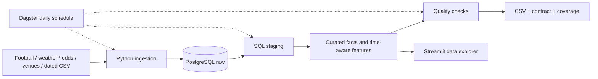

# Football Match Intelligence Data Platform

## World ranking update — 16 October 2026

The match export now includes FootballDatabase world rank and rating points for both teams, differences and capture dates: [ranking guide](docs/world-ranking.md). Current export: data/processed/world-ranking-2026-10-16/ (304 columns).

## Training enrichment update — 15 October 2026

Current odds now cover all eight competitions; weather refreshed; a chronological logistic baseline has been trained. See [coverage and remaining gaps](docs/training-data-gaps.md) and [model reproduction](docs/model-baseline.md).

HSLU · DENG · HS26 · Local batch pipeline for a match-outcome training dataset.

**The product is one documented row per match.** A data scientist can use its
pre-match features to predict HOME_WIN / DRAW / AWAY_WIN after 90 minutes.
The project delivers ingestion, PostgreSQL storage, transformation, quality
checks, orchestration and a portable export. Model development is downstream.

## Current result

Measured on 3 October 2026, after the 3 October refresh:

- **10,103 matches, 292 columns, 203 teams, eight competitions.**
- **7,985 labelled matches**, current season plus start years 2023, 2024 and 2025.
- 7,324 individual player observations in the staged squad history.
- 8,434 match rows have ten prior regular-time results for both teams.
- All critical data-quality checks pass. Missing forecasts
  remain visible warnings; optional enrichment is not fabricated.

The canonical training product is **`curated.match_training_features`**.
`curated.model_features` remains the smaller legacy dashboard view; use the new
product and its export contract for model training.

[Midterm runbook](docs/midterm-runbook.md) ·
[Architecture v0.2](docs/architecture/architecture-v0.2.md) ·
[Data model](docs/data-model.md) · [Source details](docs/data-sources.md) ·
[Team context](docs/team-context.md) · [Measured evidence](docs/evidence/multi-league-dataset.md)

## Quick start: reproducible sample demonstration

Requirements: Python >=3.10, venv support, Docker Compose and make.
On Ubuntu/WSL install `python3-venv` if needed.

```bash
./setup.sh
make up
make init
make run-samples
make dq
make verify
make export
make setup-app
make app
```

Samples contain **144 CL fixtures**, not all eight leagues. The sample targets
explicitly select CL and use recorded football, venue, weather and odds responses.
They do not contact external APIs or import a local context CSV. Use a separate
database for a sample demo if a live warehouse already exists: samples and live
responses have different raw source keys but feed the same curated tables.

`make test` creates a disposable database and never truncates the configured
warehouse. The PostgreSQL user needs CREATEDB (the Compose default has it).
Database tests skip when no PostgreSQL is reachable; they fail visibly if a
reachable server cannot create the test database.

## Build the large dataset

Put your football-data.org key in the ignored `.env`. Never commit credentials.

```dotenv
FOOTBALL_DATA_COMPETITIONS=CL,PL,BL1,PD,SA,FL1,DED,PPL
FOOTBALL_DATA_SEASONS=2023,2024,2025
FOOTBALL_DATA_TEAM_DETAILS=false
```

| Code | Competition |
|---|---|
| CL | UEFA Champions League |
| PL | Premier League |
| BL1 | Bundesliga |
| PD | La Liga |
| SA | Serie A |
| FL1 | Ligue 1 |
| DED | Eredivisie |
| PPL | Primeira Liga |

```bash
make dataset
```

This target initializes schemas, loads the eight competitions and historical
seasons, transforms every source already stored, checks quality and exports.
It deliberately fetches only football during this bulk load. To collect current
weather, venues, crests and optional odds as well, run `make run` using the profile
in `.env`; first-time geocoding is paced and can take several minutes.

The existing key was verified against all eight competition endpoints and real
historical match responses. Another account may have different permissions:
HTTP 403 fails the football run visibly. No paid subscription is purchased.

Current endpoints refresh daily. Completed historical season endpoints are
cached; `FOOTBALL_DATA_REFRESH_HISTORY=true` explicitly reloads corrections.
One initial eight-league, three-season load needs up to 80 requests
(32 current + 48 historical); the client paces them against provider limits.
More years use the same setting, subject to actual account access.

The legacy `FOOTBALL_DATA_COMPETITION=CL` is the fallback when the plural
setting is empty.

## What is in a match row?

| Family | Examples |
|---|---|
| Fixture | Competition, stage, season, kickoff calendar, home/away team IDs |
| Form | Previous 3/5/10 results, points, wins, goals, clean sheets, scoring rates |
| Context-specific form | Previous five home/away appearances; previous five in this competition |
| Season | Prior points, goals, wins and games within the same competition and season |
| Workload | Rest days and completed appearances in the prior 7/14/30 days |
| Head-to-head | Previous five meetings, both perspectives |
| Comparisons | Home-minus-away differences in points, rest, goals and season rates |
| Players | Squad size, age distribution, nationalities, position counts; player-level staging |
| Coaches | Identity, age, nationality, observed tenure, prior covered results and win rate |
| Team value | Dated EUR valuation when a supported, licensed CSV is supplied |
| Environment | Stored pre-kickoff weather forecast and bookmaker consensus |
| Target | Explicit 90-minute home/away goals and outcome, including draws |
| Evidence | Source/observation timestamps, availability and history size |

A column does not imply universal coverage. Current squads/coaches cannot fill
games from 2023. Market values are currently unpopulated. Line-ups, injuries,
player performance statistics, xG and referee history are not yet ingested.

## Time correctness

- Prediction cutoff: immediately before kickoff, **not** several days before.
- Result features use completed earlier fixtures with `kickoff + 3 hours < cutoff`.
  Three hours is a documented completion proxy; no exact final-whistle timestamp
  is supplied. These features reconstruct event history, not historical API state.
- Current/future/simultaneous results cannot enter a row's form. Extra time and
  penalties cannot be mistaken for a 90-minute outcome.
- Squad, coach, valuation, odds and weather snapshots must have been observed
  before kickoff. API snapshots use actual receipt time, never logical run date.
- Historical team responses are not treated as current squad membership.
- Rest and workload cover **ingested competitions only**; missing cups/leagues
  can make apparent rest longer than real rest.
- Split model development chronologically and fit preprocessing on training
  dates only. Do not include `label_*`, `audit_*`, IDs or raw final scores as inputs.

Daily raw snapshots and reconstruction are implemented. Immutable feature
snapshots at fixed horizons such as T-24h remain future work.

## Export and data-science handoff

```bash
.venv/bin/python -m deng.pipeline export --output data/processed/my-dataset
.venv/bin/python -m deng.pipeline export --output data/processed/labelled --labelled-only --uncompressed
```

Each **new directory** receives:

- `matches.csv.gz` (or plain CSV): ordered by kickoff and match ID.
- `manifest.json`: checksum, row counts, competitions, label distribution,
  feature/label/audit column lists, latest successful runs and quality results.
- `data_dictionary.json`: PostgreSQL types, roles and column descriptions.
- `coverage.json`: non-null counts and missingness for every column.

Export streams in batches under a repeatable-read transaction, then publishes
all files together. Existing export directories are preserved.
Large files under `data/processed/` are ignored by Git.

```python
import json
import pandas as pd

folder = "data/processed/my-dataset"
manifest = json.load(open(f"{folder}/manifest.json"))
df = pd.read_csv(f"{folder}/{manifest['file']}", parse_dates=["utc_kickoff"])
labelled = df[df[manifest["target"]].notna()].copy()
X = labelled[manifest["feature_columns"]]
y = labelled[manifest["target"]]
# Choose date cutoffs, then fit encoders/imputers only on the training period.
```

## Architecture and operation



Ingestion reads APIs, files and raw planning views; it never reads staging or
curated. Each source has a module, and raw responses carry request/run/hash
metadata. Transformations can be rebuilt without fetching APIs again.

- `make run`: ingestion -> football -> weather -> odds -> context/features -> DQ.
- `make transform`: recompute stored data without network requests.
- `make orchestrator`: Compose PostgreSQL + Dagster webserver/daemon.
- Daily Dagster schedule: 06:00 Europe/Zurich. Separate optional odds refresh job.
- `make backfill FROM=... TO=...`: replay logical ingestion dates. Today's API
  cannot recover yesterday's exact response; observation timestamps remain real.
- Transient API failures retry with backoff; permanent failures fail promptly.
- Per-stage SQL transactions prevent partially rebuilt stages. A failed quality
  check fails the run but does not undo already committed transformation stages.
- Odds remain scoped to the configured sport, CL by default. Adding football
  leagues does not automatically spend more odds credits.

## Validation and midterm boundaries

```bash
make test
make lint
make verify
```

Tests cover API failures/cache behaviour, multi-league standings, raw-layer
boundaries, schema reruns, feature windows, temporal leakage, extra-time labels,
dated snapshots, exports and an in-process Dagster run.

The local midterm implementation is delivered. Independent peer reproduction,
both students' oral defence, submission/tagging and assessment are human
milestone tasks. A grade is not guaranteed by dataset size.
GCS/BigQuery and Terraform are final-milestone work, not implemented cloud claims.
See the [rubric checklist](docs/rubric-checklist.md) and [runbook](docs/midterm-runbook.md).

## Attribution and authors

Weather data: [Open-Meteo](https://open-meteo.com/), CC BY 4.0.
Map/stadium data: [OpenStreetMap contributors](https://www.openstreetmap.org/copyright),
ODbL, obtained through Nominatim.
Football data and crests: [football-data.org](https://www.football-data.org/).
Bookmaker feeds: [The Odds API](https://the-odds-api.com/).

Elias Martinelli ([@Elias-Martinelli](https://github.com/Elias-Martinelli)) and
Noah Rodriguez ([@Noah-Rod](https://github.com/Noah-Rod)).
HSLU, DENG, autumn semester 2026.

Stadium requests commit independently and retry transient failures up to three
times; a rerun resumes missing clubs after a partial outage. Forecast requests
also retry transient failures up to three times. Permanent API errors are not retried.

The fictional odds fixtures remain available to the demonstration dashboard,
but are excluded from the canonical training product. Live odds require
ODDS_API_KEY; the current local environment has no such key.

New raw receipt times use the wall clock, even during long database transactions.
API squad/coach availability is conservatively bounded by the completed ingestion
batch, also protecting older raw rows written with transaction-start timestamps.
