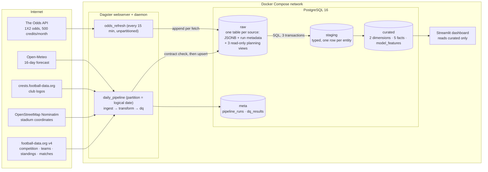

# Architecture v0.2 (Midterm)

Status: **the local pipeline as submitted for the midterm, 19 Oct 2026.**
[Architecture v0.1](architecture-v0.1.md) was the proposal at Milestone 1 and is
kept unchanged. This document records what the implementation looks like now,
which decisions changed and why, and what we learned building it. The final
version (`architecture-final.md`) will add the cloud path.

The three diagrams belong to this version:

* [`architecture-overview.svg`](../architecture-overview.svg): the three stages,
  ingest → transform → data product.
* [`architecture-detail.svg`](../architecture-detail.svg): every box named after
  the file or folder that implements it.
* [`architecture-target.svg`](../architecture-target.svg): the local path today
  next to the cloud path for the final milestone.

## 1. The pipeline in one paragraph

Once a day at 06:00 Europe/Zurich, Dagster runs one partition per logical date.
**Ingest** asks five sources in a fixed order and stores every answer unchanged
in PostgreSQL's `raw` schema, after checking that the answer contains the fields
the SQL will read. **Transform** runs 13 SQL files in three transactions:
`raw` → typed `staging` → `curated` facts and dimensions, ending in the view
`curated.model_features`, which has one row per match with the label and every
feature known before kick-off. **Quality** runs 24 checks and stores the results
in `meta.dq_results`. A CRITICAL failure fails the run; a WARNING stays visible.
A second, unpartitioned Dagster job refreshes the bookmaker odds on a credit
budget. Every step writes a row to `meta.pipeline_runs`, failures included.

## 2. Local view as built

Order inside **ingest**, and why it is this order
([`runner.py`](../../src/deng/ingestion/runner.py)):

| # | Source | Reads before asking | Fails the run? |
|---|---|---|---|
| 1 | football-data.org | nothing | yes: everything rests on it |
| 2 | OpenStreetMap | `raw.team_catalog` (clubs without a stored answer) | yes |
| 3 | club crests | `raw.team_catalog` (URLs not stored yet) | no, best effort |
| 4 | Open-Meteo | `raw.match_calendar`, `raw.venue_coordinates` | yes |
| 5 | The Odds API | `raw.match_calendar`, last fetch and quota | no, best effort |

## 3. What changed since v0.1, and why

| # | v0.1 said | v0.2 is | Why it changed | Record |
|---|---|---|---|---|
| 1 | two APIs plus a reference file `venues.csv` | **five sources**: OpenStreetMap replaces the file, crests and The Odds API are added | a hand-maintained file is not reproducible and has no provenance; OpenStreetMap answers are stored like every other answer. Odds give the model something to be compared with | [ADR-001](../adr/ADR-001-football-data-source.md) note, [ADR-005](../adr/ADR-005-bookmaker-odds-source.md) |
| 2 | fetch `teams/{id}/matches` for 36 clubs, so form covers domestic leagues too | **Champions League matches only**; form windows carry `matches_considered` | 11 of 36 clubs have no domestic data on the free tier. Mixing covered and uncovered clubs would make the same feature mean different things per club | [ADR-004](../adr/ADR-004-champions-league-scope.md) |
| 3 | "free tier = current season only" (assumed) | **past seasons are ingested once each** (`FOOTBALL_DATA_SEASONS`, load strategy `ONCE`) | the exploration run disproved the assumption: `?season=2023` answers. A finished season never changes, so it is one request, not a daily one | [api-exploration.md](../evidence/api-exploration.md) |
| 4 | one job interleaving extract and transform steps (`ingest_fixtures → … → ingest_weather → transform_*`) | **ingest everything first, transform afterwards**; ingestion may read only the APIs, `data/` and `raw` | before the restructure, 14 lines of ingestion code read `staging`/`curated`, so a transformation had to run mid-ingestion and the product could not be rebuilt from the stored answers. Three views over `raw` (`009`, `010`) now answer the planning questions | [restructure.md](../evidence/restructure.md), `tests/test_layering.py` |
| 5 | a separate `validate raw` box between extract and load | **payload contracts inside the ingest step, before the write** | a separate step would have to read what was already stored, so a broken answer would be in the raw zone first. Checking before the write keeps it out, and the day's earlier answers are rolled back with it. The price: a rejected answer is not archived, which for a forecast cannot be made up later ([failure-behaviour.md](../failure-behaviour.md), *What is not covered*) | [`contracts.py`](../../src/deng/sources/contracts.py), [failure-behaviour.md](../failure-behaviour.md) #5 |
| 6 | Dagster *proposed* | Dagster **accepted**; daily partitions with `end_offset=1`; a second unpartitioned job for odds | the spike showed partitions are backfills. The default last partition is *yesterday*, which would have stored today's API state under yesterday's date, hence the offset. Odds belong to a minute, not a day, so they cannot share the partitioned job | [ADR-002](../adr/ADR-002-workflow-orchestrator.md) |
| 7 | transformation tool open (dbt or plain SQL) | **plain SQL files** run in order by a 158-line Python runner; the odds event matcher is Python inside the transformation | 13 files, no macros needed; one fewer tool to explain and install. Fuzzy name matching is not something SQL does well | [`transformation/runner.py`](../../src/deng/transformation/runner.py) |
| 8 | `fact_match_snapshot` from the midterm on | **deferred to the final**; `curated.model_features` (a view, one row per match) is the interim product | the snapshot is only meaningful with several weeks of daily runs behind it, and its partitioning is a BigQuery question. The view gives a model-ready table now without anything to keep in sync | backlog 6.5, 6.8 |
| 9 | raw zone "immutable, append-only" | **upsert per source, question and day**; odds append-only | a rerun on the same day must not duplicate. The payload hash shows whether the answer changed (`UPDATED` vs. `UNCHANGED`). Odds are the exception because their intraday history *is* the data | [ADR-003](../adr/ADR-003-raw-data-storage.md), `raw_loader.py` |
| 10 | weather: forecast plus historical archive | **forecast only, today only**, with an availability state per match | a forecast fetched after kick-off is not a forecast: the leakage guard discards it, and a backfill fetches no weather at all. Archive actuals are a different feature, deferred | backlog 2.7 |
| 11 | Streamlit "optional fixture viewer" | an **analysis dashboard** over `model_features`: dataset size, feature coverage with the reason a value is missing, leakage guarantees recomputed | the end user is a data scientist judging the data before training on it, not a fan looking at one match | backlog 13.6 |

What did **not** change: raw first, three layers, idempotent upserts on business
keys, daily batch, Docker Compose with one network, Dagster, and the cloud target
(GCS + BigQuery via Terraform).

## 4. Lessons learned

1. **An architecture rule needs a test, or it erodes.** "Ingestion never reads
   curated" was the intention from day one, and 14 lines broke it within the first
   week, each for a locally reasonable reason. A 40-line grep test
   (`test_layering.py`) now fails the build instead.
2. **Measure the source before designing around it.** Two assumptions in v0.1
   were wrong: the free tier serves past seasons, and its aggregates are
   inconsistent. Committing the real answers as samples made every later
   decision checkable.
3. **"Today" is a dependency.** Four bugs came from dates: the Dagster default
   partition (yesterday), the CLI's default date (UTC instead of Zurich),
   `match_date` taken from the session time zone instead of the UTC day, and
   three tests that only passed before a given match kicked off. Each is now
   pinned to an explicit logical date or clock.
4. **Classify errors once, at the source.** Splitting `RetryableApiError` from
   `ApiError` in the clients made every later decision simple: the client
   retries seconds apart, Dagster minutes apart, and everything else fails at
   once. Schema drift fits in as one more permanent `ApiError`.
5. **Best effort must be explicit.** Crests and odds may fail without failing
   the run, and that is a flag on the step (`best_effort=True`), a WARNING
   check, and a line in the output. It is never a bare `except`.
6. **Reproducibility breaks where nobody looks.** The clean-environment test on
   18 October found that a fresh install resolved SQLAlchemy 2.1, which stopped
   Dagster from launching any run. Our own machines still had 2.0. Upper bounds
   on fast-moving dependencies are part of the architecture.
7. **Backfill re-labels, it does not reconstruct.** The APIs answer with
   today's state, so a backfill for a past date recovers a missed run but not
   what was known then. That is why the snapshot table (one row per match per
   day, filled by the daily run itself) is the real training table, and why it
   has to start collecting early in the final phase.

## 5. Known gaps carried into the final milestone

* Cloud path: Terraform (bucket, dataset, service account), raw writer to GCS
  without a local intermediate file, BigQuery staging and curated with
  partitioning and clustering, the same quality checks against BigQuery.
* `curated.fact_match_snapshot` and `dim_date`.
* Schema contracts for The Odds API and OpenStreetMap (today: type check only,
  judged by the venue and odds quality checks).
* A first live odds fetch with a real key (all odds evidence so far replays the
  committed samples).

## 6. Division of responsibilities

The ownership table of [v0.1 §6](architecture-v0.1.md#6-division-of-responsibilities-proposal)
remains the reference, with the same rule: every pull request is reviewed by the
other student, and both must be able to explain the whole pipeline. The cloud
work for the final milestone (Terraform, GCS, BigQuery model, partitioning)
starts as a pair session and is then split by table, as v0.1 planned.
